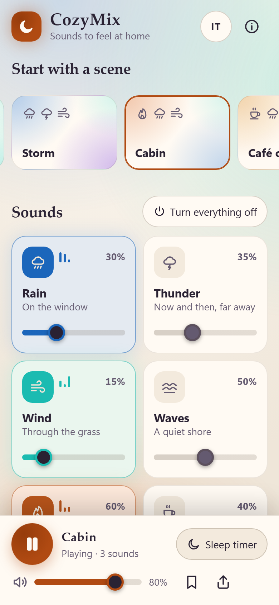
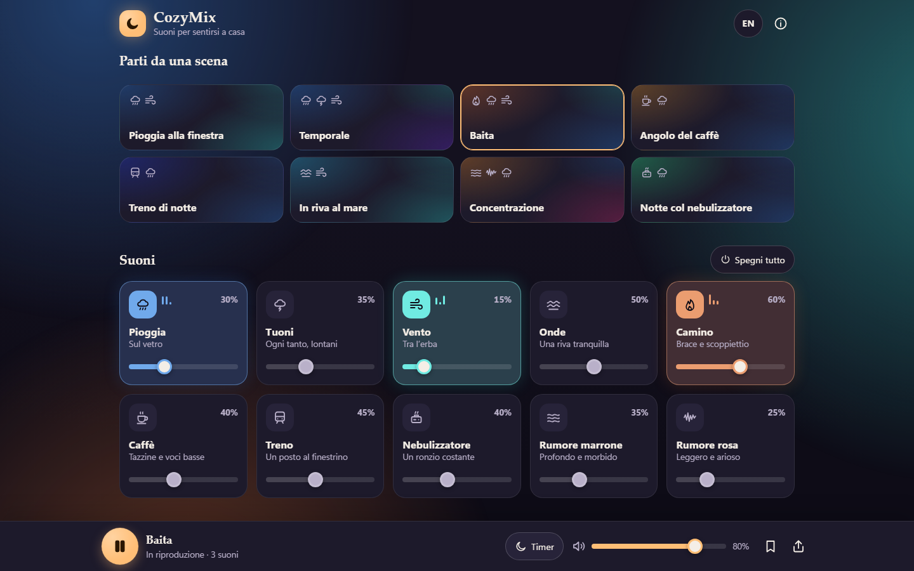

# CozyMix

[](https://github.com/SimoneNuts/cozymix/actions/workflows/deploy.yml)

**▶ Try it: [simonenuts.github.io/cozymix](https://simonenuts.github.io/cozymix/)**

<p align="center">
  
  
</p>

**Sounds to feel at home.** An ambient sound mixer for focus, rest or sleep. It has rain on the window, a fireplace, a café, a night train, waves, a stream, wind and soft noise. Turn on the sounds you like, set each one's volume, and let everything else fade away.

No account, no ads, no tracking. Everything stays on your device, and after the first visit it works offline too.

<p align="center">
  
</p>

## How it works

- **Tap a sound** to turn it on, and it starts right away. Tap it again to turn it off.
- **The slider under each sound is its volume**, and it is always visible. Moving the slider of a sound that is off turns it on.
- **Scenes** are ready-made mixes such as Storm, Cabin, Night train and Seaside. Changed your mind? Press *Undo*.
- **The player at the bottom** is always within thumb reach. It has play/pause, the overall volume, a sleep timer, Save and Share.
- **Save** your mixes under a name, then find them again in *Your mixes*.
- **Share** makes a link. Whoever opens it gets your mix, which never starts playing on its own.
- **Sleep timer:** choose 15 to 90 minutes. The mix fades out over the last 30 seconds, then pauses.
- **Space** plays and pauses.
- **English and Italian:** the language is picked from your browser and can be switched from the top bar.
- **Dark and light themes** follow your system setting.

## The sounds

Eight are real recordings, each CC0, CC BY-SA or original. Two are synthesized right in the browser: waves and brown noise. Sources and licenses are listed in [SOUND_SOURCES.md](SOUND_SOURCES.md).

## Development

You need Node.js 22.18 or newer.

```bash
npm install
npm run dev          # http://localhost:3000
```

| Command | What it does |
| --- | --- |
| `npm run dev` | Development server. It removes any service worker left behind by an earlier build. |
| `npm run lint` · `npm run typecheck` · `npm test` | Fast checks: ESLint, TypeScript and Node tests. |
| `npm run build` | Exports the static site to `out/`. |
| `npm run preview` | Serves `out/` the way GitHub Pages would. |
| `npx playwright test --project=chromium` | Browser tests on the exported site, with real audio. Run `npm run build` first. |
| `npm run icons` | Regenerates the app icons. |

## Deployment

The site is static and deploys itself to **GitHub Pages**. On every push to `main`, the [Check and deploy](.github/workflows/deploy.yml) workflow runs lint, typecheck, the Node tests and the browser tests in Chromium, Firefox and WebKit. It publishes `out/` only if all of them pass. Pull requests run the same checks without publishing.

On Pages the app lives under `/cozymix/`, and the build learns this from `NEXT_PUBLIC_BASE_PATH`:

```bash
NEXT_PUBLIC_BASE_PATH=/cozymix npm run build   # same as GitHub Pages
npm run preview                                 # http://127.0.0.1:3000/cozymix/
```

On Windows with Git Bash, put `MSYS_NO_PATHCONV=1` in front of the build command. Otherwise Git Bash turns `/cozymix` into a system path; the build detects this and stops. On a custom domain, leave the variable empty.

## Further reading

- [ARCHITECTURE.md](ARCHITECTURE.md): how the code is built.
- [AGENTS.md](AGENTS.md): guidance for contributors and coding agents.
- [CHANGELOG.md](CHANGELOG.md): what changed.
- [ROADMAP.md](ROADMAP.md): what comes next.

## License

The code is MIT ([LICENSE](LICENSE)). The recordings carry the licenses listed in [SOUND_SOURCES.md](SOUND_SOURCES.md).
